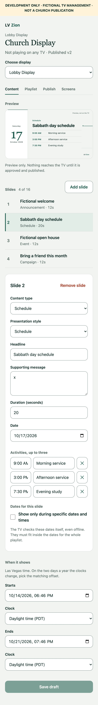
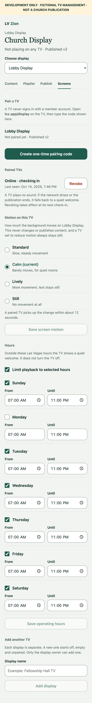
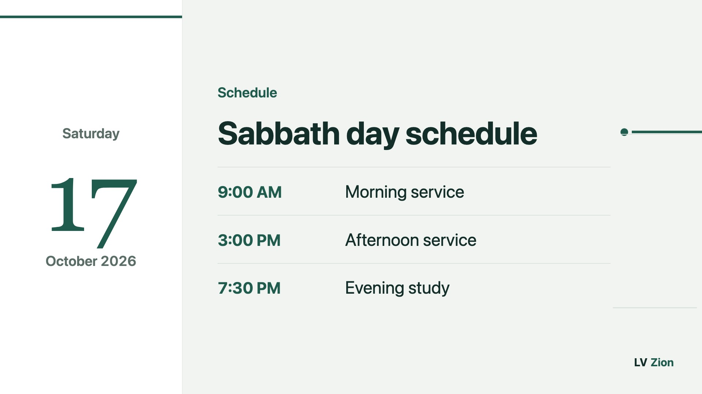
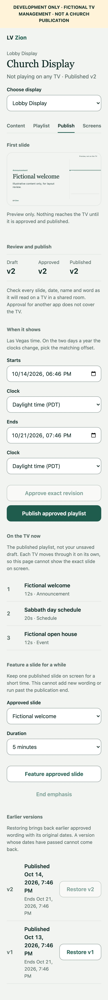
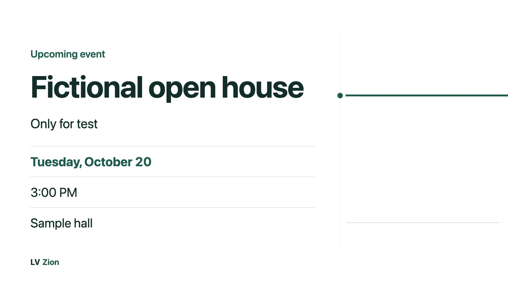
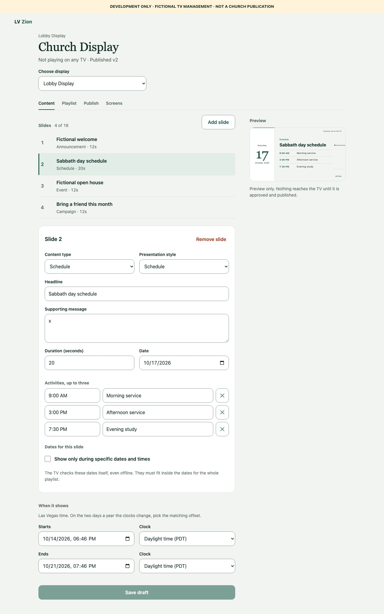
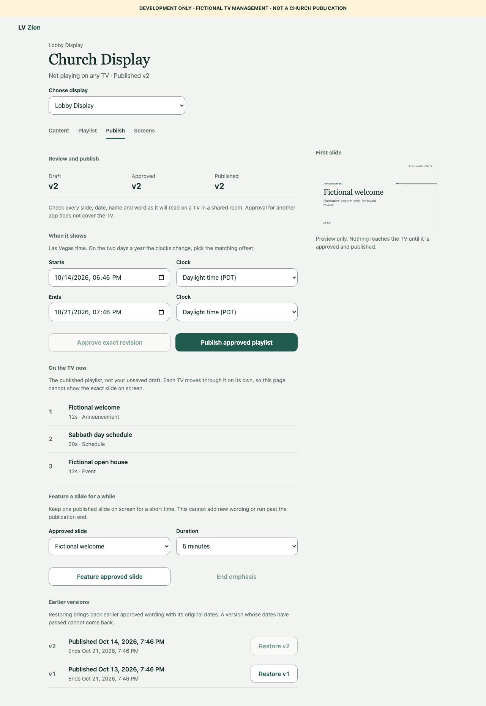
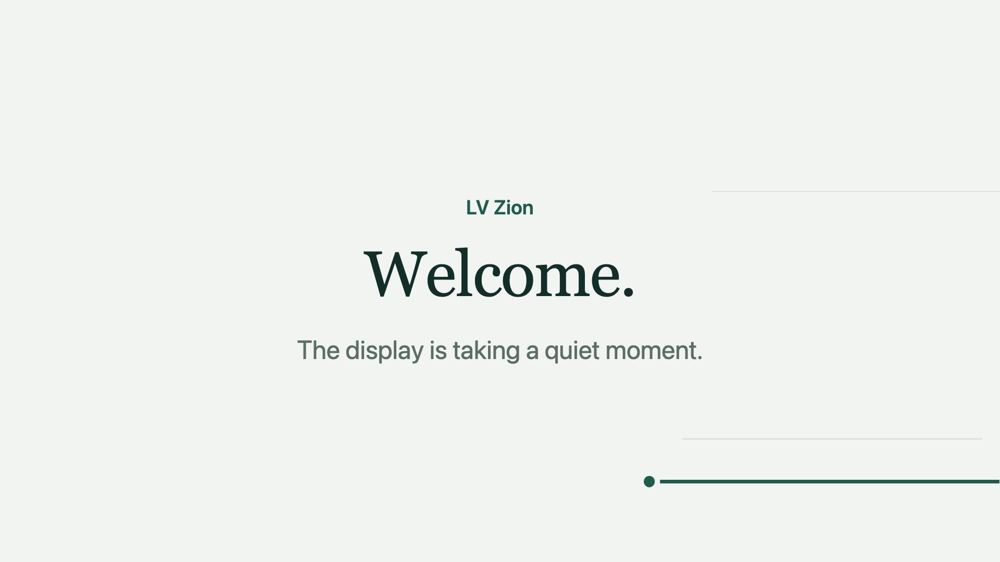
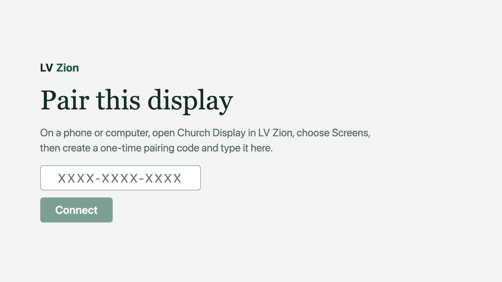

# Church Display: Day Sheet redesign

Follows [the design contract](../../design/LVZ-DESIGN-CONTRACT.md). Screenshots use fictional content only (the `/display-operations-review` fixture and mocked TV responses).

## Manager (phone and desktop)

- Shared header (wordmark goes home), serif page title, underlined tabs with sideways swipe.
- Rows on the ground instead of cards; the slide editor is the one white surface.
- One primary button per tab: Save draft, Save playlist draft, Publish approved playlist, Create one-time pairing code.
- Desktop adds a 320px TV preview column; phones show the preview first.
- Notices are toned: success, warning or problem.

## TV surface

- Text sized in container units so it reads from across a room on any TV.
- Decoration is thin ruled lines and a slow "now" line, matching the day sheet. No circles, gradients or glow.
- The four per-screen motion settings (Standard, Calm, Lively, Still) retime the same lines. Still and the TV's own reduce-motion setting stop all movement.
- Campaign slides are the one full-color surface (white on spruce).

## Checked

320, 390 and 1280px widths with no sideways scrolling, every control at least 44px, visible 3px focus ring on keyboard focus, colors only from the shared tokens.

| Manager | TV |
| --- | --- |
|  |  |
|  |  |
|  |  |
|  |  |
|  |  |
| |  |
